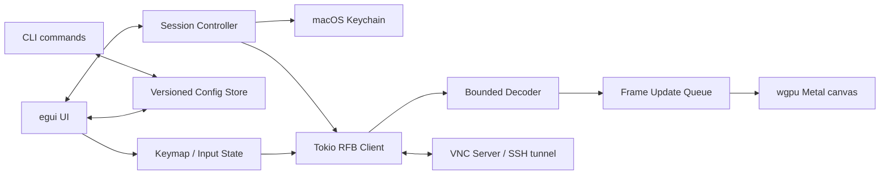
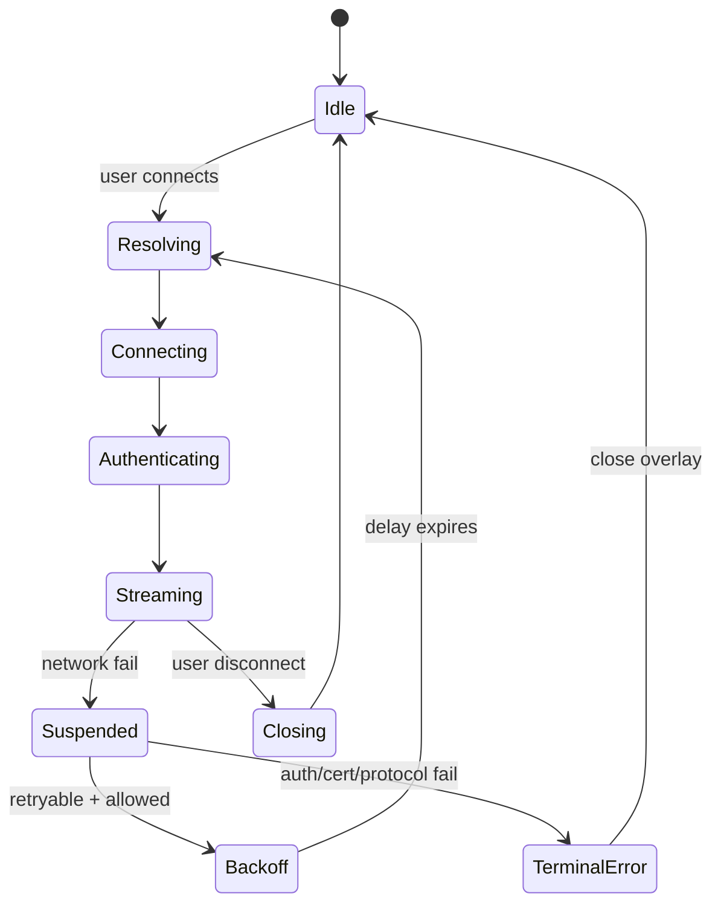

# Architecture / engineering design

## Preferred stack

| Layer | Choice | Why / tradeoff |
|---|---|---|
| Language | Rust stable (2021 edition) | memory safety for remote untrusted parser; mature tooling |
| Native GUI | `eframe 0.37` + `egui` | rapid development and dark UI; **verify macOS13 + Intel Metal** |
| Rendering | `eframe` wgpu/Metal; **done (2026-11-19)**: RFB dirty-rect updates are applied to a persistent CPU framebuffer and only changed rectangles are uploaded (`TextureHandle::set_partial`); full upload only on first frame / resize | high-resolution framebuffers must not force full-screen GPU copies per update |
| Concurrent IO | `tokio` | cancellable asynchronous socket; worker thread never blocks UI |
| Config | `serde_json`, versioned schema, atomic save | same GUI+CLI; human-readable; no secrets |
| Secrets | macOS Keychain through `keyring` (apple-native) | no homegrown password encryption; signing identity caveats |
| Protocol | Safe Rust RFB core with Raw + CopyRect + ZRLE (zlib, persistent per-connection stream, RFC 6143); LED State pseudo-encoding | bounded, testable decoding; no C dependencies; ZRLE gives lossless compression on LAN drags |
| Packaging | signed `.app`, same Rust executable accessible from CLI | standard macOS deployment; CLI may symlink app binary after review |
| Testing | Rust tests + controlled RFB server + Intel device + fuzz | only real x86_64 macOS can validate GPU/UI behavior |

## Runtime data flow

## Code / module boundaries

- `glintvnc-core::configuration` — profile schema, versioning and atomic persistence. No Keychain fields.
- `glintvnc-core::secrets` — narrow Keychain adapter keyed by immutable profile ID.
- `glintvnc-core::protocol` — P0 proof-of-connection RFB; replace with `RfbTransport` abstraction after P0 verification.
- `glintvnc-core::input` — pure unit-testable keysyms/translations; later move native event mapping into macOS adapter.
- `glintvnc-core::reconnect` — deterministic backoff policy (introduce jitter in P1).
- `glintvnc-app::ui` — eframe front end; no decoding/IO on UI thread.
- `glintvnc-app::main` — CLI dispatch and GUI launch, one executable.

## Session state machine (target P1; P0 has reduced implementation)

## Concurrency / bounded work

- Networking, DNS, **Keychain access** and frame decoding run in background workers (: no `keyring` call on the UI thread, including interactive approval). When profiling shows frame decode CPU impact, spawn bounded Rayon workers or tokio `spawn_blocking`, but preserve ordered rectangle application.
- Use bounded channels (sync_channel(2), deliberately retained so the UI can never be flooded). No unbounded remote-driven allocations.
- Render latest complete frame, not every update when UI is behind. **Done (2026-11-19): RFB updates are applied as dirty rectangles (Combine per server update); the UI patches a persistent `ColorImage` and performs `partial texture uploads` per rect (resize/first-frame still full).** Never tear rectangles.
- Use strict max negotiated pixels (**: <=16M pixels / 64 MiB RGBA**), per-message max size, decompression ratio ceilings, rectangle count caps, **and a 128 MiB per-update RGBA damage budget checked before allocation**. All network reads (handshake, update payload, clipboard) have a 15-second inactivity timeout; EOF is retryable so auto-reconnect behaves consistently.
- On connection generation change, cancel prior read/decoder, discard stale frames and key state. Never apply stale frame to a new host.

## Pixel transforms

`source framebuffer pixels (W,H) → cropped/letterboxed content rect (x0,y0,cw,ch) → available native points and Retina scale factor`. Map pointer to framebuffer via `(cursor - rect.origin) / rect.size * (W,H)` then clamp, and ignore clicks outside content rect. Test 1:1, fit, stretch, zoom, odd aspect ratios, multiple displays with differing backing scale.

## Security boundary

All remote stream bytes / desktop name / clipboard text are untrusted. Keychain is OS-protected; profile JSON is not an authentication store. TCP RFB VNCAuth is DES legacy and does **not** encrypt screen traffic. P0 permits non-loopback only with explicit profile opt-in and rejects unsupported TLS rather than downgrading. Encrypted client connections require verified VeNCrypt or SSH/WireGuard external tunnel, with certificate chain/hostname verification.

## Frame streaming (as-built, 2026-11-19)

RFB server → tokio task decodes each update into a persistent CPU canvas → emits `Event::Frame { width, height, rects: Vec<DirtyRect> }` (with a 128 MiB per-update RGBA budget; `DesktopSize` forces the next request to be non-incremental per RFC 6143) (only changed rectangles, ~KBs during drags vs 8.3MB/frame) → event channel (sync_channel(2)) → root window patches a persistent `egui::ColorImage` → repaints the session window by wake → `TextureHandle::set_partial` per dirty rect. The session viewport no longer repaints on a 16ms timer; it wakes on protocol events and only re-schedules itself for the floating bar's timed auto-hide.

## Input path (as-built, 2026-11-19)

UI → worker commands: **unbounded** `tokio::mpsc::UnboundedSender<protocol::Command>` (a full bounded channel previously caused silent loss of pointer-release events). Pure pointer motion is throttled client-side to one message per 16ms with a latest-wins pending slot (`MotionThrottle`, unit-tested); button-mask changes bypass the throttle and send immediately; any pending motion is flushed before a button press/release edge (message order preserved). The worker (`read_update`) dispatches queued commands **between rectangles** of an update (Connections → Snapshot → Raw/CopyRect/ZRLE) instead of only at update end, so pointer events reach the server while a large screen re-encode is still being transferred. Focus loss / reconnect releases held keys **and** pointer buttons via the same never-drop path. `Event::Closed` also drops the last texture so the reconnect overlay is always reachable, and a detached reaper thread joins each worker on session removal. F8 toggles the floating bar for keyboard-only users; Esc exits fullscreen when the bar is hidden; ⌘R and F8 are local-only commands. A **Refresh** command (floating bar / ⌘R) forces a full non-incremental `FramebufferUpdateRequest`, which rebuilds the framebuffer from scratch server-side; client-side it flows through the same dirty-rect path as any update.

## Technical decisions and fallback paths

1. First try `eframe/wgpu` on Intel. If Metal startup fails, explore `egui_glow` (OpenGL is deprecated but available on Ventura) or a compatible eframe version. Document benchmark costs and minimum OS.
2. Compare `madeye/rv` GPUI native UI & RFB stack, `hkder/ironvnc` codecs, and `psmux/DeskVNC` protocol implementation before writing complex codecs. Prefer reusing permissively licensed protocol code with attribution if compatible, after auditing APIs & safety.
3. Replacing P0 Raw engine needs an adapter and test suite, not a rewrite of GUI/profile management.
4. Memory use and bandwidth are solved by incremental subrectangle uploads (shipped 2026-11-19). The one remaining full-frame re-upload happens only on resize/first frame (egui has `set_partial`, not a cheaper full path).
5. Do not promise built-in Apple ARD username login until actual Intel/macOS tests prove the implementation. GUI holds the username metadata in anticipation.
